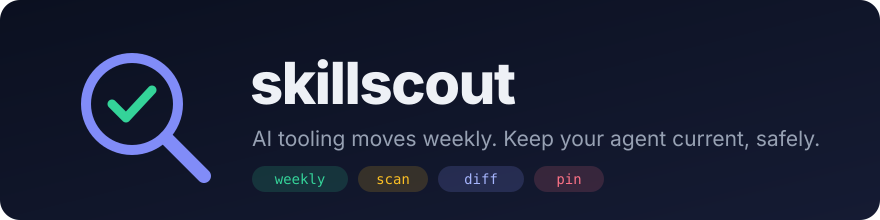

<p align="center">
  
</p>

<p align="center">
  <a href="https://akshit9162.github.io/skillscout">Website</a> &ensp;·&ensp;
  <a href="#install">Install</a> &ensp;·&ensp;
  <a href="#how-it-works">How it works</a> &ensp;·&ensp;
  <a href="#what-gets-flagged">What gets flagged</a>
</p>

<p align="center">
  <a href="LICENSE"></a>
  <a href="https://github.com/akshit9162/skillscout/actions/workflows/ci.yml"></a>
  
  
</p>

There are thousands of agent skills on GitHub now, and a skill is a set of instructions your coding agent follows
**with your permissions**. Installing one you haven't read is like piping a stranger's script into your shell.

**skillscout** finds the skills worth having for *your* work, flags the ones that do something dangerous,
and installs only the ones you approve, each pinned to an exact commit. Updates are shown as a diff and
re-scanned before they can replace what you installed.

In one run over the public ecosystem it scanned **95 repos and 6,726 skills**: 198 had at least one high-risk
flag (mostly `sudo` and `curl | sh` install steps, plus prompt-injection-style text and hidden Unicode).

It's a zero-dependency Python CLI, and it also ships as a skill, so your agent can run the whole loop for you
and still ask before every install.

## Install

### As a Claude Code plugin (the agent drives it)

```sh
claude plugin marketplace add akshit9162/skillscout
claude plugin install skillscout@skillscout
```

Then ask: *"find me skills for my Python and React work"*. The agent installs the CLI, runs the search,
summarises the report and shows you each skill's flags before asking to install it.

### As a CLI

```sh
pipx install git+https://github.com/akshit9162/skillscout     # or: uv tool install git+https://...
skillscout init                                              # writes ~/.skillscout/profile.toml
```

Edit `[keywords]` in `~/.skillscout/profile.toml` with the words from your own work, then:

```sh
skillscout discover          # search, scan, score; writes ~/.skillscout/reports/<date>.md
skillscout list              # ranked; REC = recommended
skillscout show <id>         # every flag plus the full SKILL.md, before you decide
skillscout approve <id>      # copy into ~/.claude/skills and pin the commit
```

`<id>` is `owner/repo:skill-name`. The bare skill name works when it's unique.

## How it works

| Step | What happens |
|---|---|
| **Discover** | Runs your GitHub searches (topics like `claude-skills`, `agent-skills`) plus your trusted repos. Drops archived, stale (no push in a year), unpopular and huge repos. |
| **Clone** | Sparse, shallow clones: only folders that contain a `SKILL.md`, minus media and archives. Repo code is never run. |
| **Scan** | Static checks on every file in the skill, reported with file and line ([below](#what-gets-flagged)). |
| **Score** | 65% relevance to your keywords, 20% stars, 15% freshness, plus a bonus for trusted repos. |
| **Conflicts** | Compared against your `~/.claude/skills` and plugin skills: same name, or a description close enough that both would fire on the same prompt. |
| **Report** | Recommended skills, plus relevant ones that are blocked and why. |
| **Approve** | You pick one. It's copied (symlinks dropped) and pinned in `~/.skillscout/skills.lock.json` with its commit and a content hash. |
| **Update** | `skillscout updates` diffs each pinned skill against upstream and applies nothing. Taking an update re-runs the scan. |

## What gets flagged

| Level | Patterns |
|---|---|
| **High**, blocks install | Download piped into a shell · `sudo` · broad `rm -rf` · reading SSH keys or the keychain · decode-and-execute · uploading local files · hidden or direction-changing Unicode · "ignore previous instructions" · "don't tell the user" |
| **Medium** | Reading `.env` or API keys · force pushes · editing shell profiles or Claude settings · skipping permission prompts · hooks · scripts that make network calls · symlinks · binaries |
| **Low** | Other bundled scripts · no licence |

High-risk skills need `--accept-risk`, which the bundled skill tells the agent never to pass on its own.

## Safety rails

- Nothing installs without an explicit `approve`.
- `approve` never overwrites a folder skillscout didn't install, and never follows symlinks.
- Every install is pinned to a commit and a content hash.
- Updates are a diff first, and re-scanned before they replace anything. The test suite includes an upstream
  update that slips in `sudo rm -rf /`, and checks that re-approval refuses it.

## Every command

| Command | Does |
|---|---|
| `skillscout init` | Copy the example profile to `~/.skillscout/profile.toml` |
| `skillscout discover [--notify]` | Search, scan, score, write the report (`--notify` = macOS notification) |
| `skillscout list [--all] [-n N]` | Ranked candidates |
| `skillscout show <id>` | Flags, conflicts and the full SKILL.md |
| `skillscout approve <id> [--update] [--accept-risk]` | Install and pin |
| `skillscout installed` · `skillscout remove <id>` | Pinned skills · uninstall |
| `skillscout updates` | Diff pinned skills against upstream |
| `skillscout schedule` | Write a weekly launchd job (macOS); you turn it on with `launchctl load` |

Set `GITHUB_TOKEN` for higher API rate limits. It's optional.

## Limits

- The scanner catches known patterns. It can't prove a skill is safe, so read `show` before you approve.
- Relevance is keyword matching against your profile, not semantic search. Tune the weights.
- Every installed skill's description loads into every agent session. Keep the total to a few dozen.

## Development

```sh
python3 -m venv .venv && .venv/bin/pip install -e ".[dev]"
.venv/bin/python -m pytest -q
```

## License

MIT
